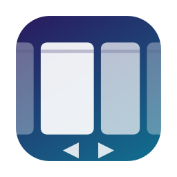
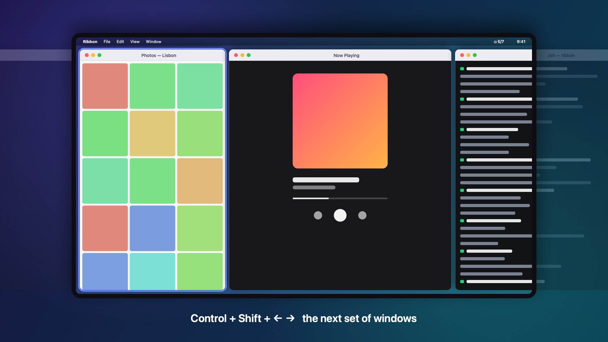

<p align="center">
  
</p>

<h1 align="center">Ribbon</h1>

<p align="center">
  <b>A scrolling window manager for macOS.</b><br>
  Your windows sit side by side on one endless canvas. Each keeps its own width, and your screen slides along them.
</p>

<p align="center">
  <a href="https://github.com/TararaDotJoshua/ribbon/actions/workflows/ci.yml"></a>
  
  
  <a href="LICENSE"></a>
</p>

<p align="center">
  <a href="media/ribbon-tour.mp4"></a><br>
  <a href="media/ribbon-tour.mp4">▶ Watch the 34-second tour</a>
</p>

Most window managers squeeze every window onto one screen. Ribbon doesn't.
Windows are columns in an endless horizontal strip, the screen is a viewport
onto it, and moving between windows scrolls the strip. Opening, closing or
resizing a window never changes the width of any other window. The design
follows [niri](https://github.com/YaLTeR/niri), PaperWM and
[Paneru](https://github.com/karinushka/paneru). The tab groups are modelled on
[TrellisWM](https://trelliswm.app).

> **Status: early prototype.** Ribbon is usable every day on a single display,
> but expect rough edges. Issues and pull requests are welcome.

## Features

- **Endless canvas.** Windows line up left to right. Those off screen wait at
  the screen's edge, so nothing gets lost.
- **Keyboard navigation.** <kbd>⌃</kbd> + arrows moves window to window,
  scrolling only as far as needed. <kbd>⌃</kbd> <kbd>⇧</kbd> + arrows jumps to
  the next *set* of windows.
- **Widths that stay put.** Step through ⅓ · ½ · ⅔ · full, nudge by 5%, or
  drag a window's edge, and Ribbon remembers. Apps with minimum sizes get the
  width they insist on.
- **Tab groups, across apps.** Drop one window on the middle of another and
  they become tabs of one column, with a tab bar on top.
- **Moves that never overlap.** Windows snap into place instantly, in an order
  where no window lands on another. Turn on Smooth Motion to glide the whole
  canvas instead.
- **One strip per Space**, saved across restarts.
- **Menu bar app** with an on/off switch. When off, your windows are left alone
  and the shortcuts go back to macOS.
- **Scriptable.** Every action is a command, and a JSON config sets gaps, width
  presets and key bindings.

<p align="center">
  
  
</p>

## Install

You need macOS 14 Sonoma or later and the Swift 6 toolchain (Xcode 16, or the
Command Line Tools).

```sh
git clone https://github.com/TararaDotJoshua/ribbon.git
cd ribbon
./scripts/bundle.sh --install
```

This builds `Ribbon.app`, copies it to `~/Applications` and launches it. Ribbon
lives in the menu bar (◫) and has no Dock icon.

**Accessibility permission.** macOS only lets apps you trust move windows. On
first launch, turn on Ribbon in System Settings › Privacy & Security ›
Accessibility, and Ribbon starts by itself. The build is signed ad hoc, so macOS
treats every rebuild as a new app. After reinstalling, remove Ribbon from that
list with **−** and launch it again.

**Ctrl+arrows and Spaces.** macOS uses <kbd>⌃</kbd> <kbd>←</kbd> /
<kbd>→</kbd> to switch Spaces. While Ribbon is on, it catches those keys before
macOS does. If Spaces still switch, turn off **Move left/right a space** in
System Settings › Keyboard › Keyboard Shortcuts › Mission Control.

## Usage

### Keyboard

| Keys | Action |
|---|---|
| <kbd>⌃</kbd> <kbd>←</kbd> / <kbd>→</kbd> | Focus the previous / next window |
| <kbd>⌃</kbd> <kbd>⇧</kbd> <kbd>←</kbd> / <kbd>→</kbd> | Previous / next set of windows |
| <kbd>⌃</kbd> <kbd>⌥</kbd> <kbd>←</kbd> / <kbd>→</kbd> | Narrower / wider, through the width presets |
| <kbd>⌃</kbd> <kbd>⌥</kbd> <kbd>R</kbd> | Cycle the width presets |
| <kbd>⌃</kbd> <kbd>⌥</kbd> <kbd>-</kbd> / <kbd>=</kbd> | Narrower / wider by 5% |
| <kbd>⌃</kbd> <kbd>⌥</kbd> <kbd>F</kbd> | Fill the screen; again to restore the width |
| <kbd>⌃</kbd> <kbd>⌥</kbd> <kbd>C</kbd> | Center the focused window |
| <kbd>⌃</kbd> <kbd>⌥</kbd> <kbd>⇧</kbd> <kbd>←</kbd> / <kbd>→</kbd> | Move the window left / right in the strip |
| <kbd>⌃</kbd> <kbd>⌥</kbd> <kbd>[</kbd> / <kbd>]</kbd> | Tab the focused window into its left / right neighbour |
| <kbd>⌃</kbd> <kbd>⌥</kbd> <kbd>\\</kbd> | Move the focused tab out into its own column |
| <kbd>⌃</kbd> <kbd>⌥</kbd> <kbd>↑</kbd> / <kbd>↓</kbd> | Previous / next tab |
| <kbd>⌃</kbd> <kbd>⌥</kbd> <kbd>T</kbd> | Float / tile the focused window |
| <kbd>⌃</kbd> <kbd>⌥</kbd> <kbd>P</kbd> | Turn Ribbon off / on |
| <kbd>⌃</kbd> <kbd>⌥</kbd> + scroll | Pan the canvas freely |

Clicking a window, or switching to it with <kbd>⌘</kbd> <kbd>Tab</kbd>,
scrolls it into view.

**Next set of windows.** <kbd>⌃</kbd> <kbd>⇧</kbd> <kbd>→</kbd> brings the
first window that isn't fully visible to the left edge of the screen, so you
see a whole new set. <kbd>⌃</kbd> <kbd>⇧</kbd> <kbd>←</kbd> does the reverse:
the last hidden window on the left lands at the right edge. Pages stop at the
ends of the strip rather than showing empty canvas.

### Tab groups

Drag a window by its title bar over the middle of another, hold until **Add as
Tab** appears, and let go. The windows can belong to different apps. Then:

- Click a tab to switch to it.
- Drag a tab out of the bar to make it its own window again.
- Right-click a tab to show, move out or close it.

A group moves, resizes and scrolls like a single window. Background tabs are
tucked out of sight in the screen's bottom-right corner.

### Menu bar

The ◫ icon shows the focused window's position (`2/5`) and dims while Ribbon is
off. Its menu has:
- **Ribbon On**, the on/off switch;
- **Smooth Motion**;
- **Retile Windows**;
- a **Keyboard Shortcuts** list;
- **Start at Login**;
- **Open Config…** and **Reload Config**;
- **Quit Ribbon**, which puts every window back on screen.

## Configuration

`~/.config/ribbon/config.json`. **Open Config…** in the menu creates a sample.
Every key is optional.

```json
{
  "gap": 8,
  "widthPresets": [0.3333, 0.5, 0.6667, 1.0],
  "defaultWidth": null,
  "widthStep": 0.05,
  "sliver": 5,
  "tabBarHeight": 28,
  "animationDuration": 0.12,
  "panModifiers": "ctrl+alt",
  "panSpeed": 1.0,
  "excludeApps": ["com.apple.systempreferences"],
  "bindings": { "cmd+alt+l": "focus-right", "ctrl+alt+t": "none" }
}
```

| Key | Meaning |
|---|---|
| `gap` | Points between windows and around the strip |
| `widthPresets` | Width ratios that grow, shrink and cycle-width step through |
| `defaultWidth` | Width for new windows; `null` keeps each window's own width |
| `widthStep` | How much widen / narrow change the width |
| `sliver` | Points of an off-screen window left showing at the edge |
| `tabBarHeight` | Height of the tab bar above a tab group |
| `animationDuration` | Seconds a glide takes when Smooth Motion is on |
| `panModifiers`, `panSpeed` | Scroll-wheel panning; `""` turns it off |
| `excludeApps` | Bundle IDs or app names Ribbon never touches |
| `bindings` | Key combo → command, merged over the defaults; `"none"` unbinds |

In key combos, modifiers are `ctrl`, `alt`, `shift` and `cmd`. Keys are
letters, digits, `left` `right` `up` `down`, `minus`, `equal`, `leftbracket`,
`rightbracket`, `backslash`, `return`, `space`, `tab`, `escape` and so on.

## Command line

```sh
Ribbon send <command>     # run a command in the running Ribbon
Ribbon list               # which windows Ribbon would tile (moves nothing)
Ribbon --only <app>       # manage just this app (repeatable), for testing
Ribbon --config <path>    # use another config file
```

Inside the app bundle, the binary is at
`~/Applications/Ribbon.app/Contents/MacOS/Ribbon`. The commands are
`focus-left`, `focus-right`, `page-left`, `page-right`, `move-left`,
`move-right`, `grow`, `shrink`, `cycle-width`, `widen`, `narrow`,
`toggle-fill`, `center`, `toggle-float`, `tab-into-left`, `tab-into-right`,
`untab`, `prev-tab`, `next-tab`, `retile`, `toggle-pause`, `dump` and `quit`.
`dump` writes the layout to `~/Library/Logs/Ribbon.log`.

## How it works

Ribbon is a plain Swift package with no dependencies.

- **`RibbonCore`** is the layout model, a pure value type with unit tests: the
  strip of columns, the scroll offset, focus and paging rules, width presets,
  tab groups, and the target frame of every window.
- **`Ribbon`** is the macOS side:
  - The Accessibility API finds, watches, moves and resizes windows.
  - One `AXObserver` per app reports window events.
  - A HID-level `CGEventTap` handles key bindings and scroll panning.
  - Non-activating panels draw the tab bars.

Every change runs the same loop. A command or window event updates the strip;
the strip computes target frames; the controller moves only the windows that
differ, choosing an order in which no window lands on one still in its way.

macOS won't place a window entirely off screen, so windows outside the viewport
are parked at the edge with a few points showing. Background tabs are tucked
into the bottom-right corner.

To do what public APIs can't, Ribbon uses a few **private macOS APIs**, the same
ones Paneru, yabai and AeroSpace use:
- `_AXUIElementGetWindow` for window IDs;
- SkyLight's `_SLPSSetFrontProcessWithOptions` and `SLPSPostEventRecordTo` to
  focus one specific window;
- `SLSCopySpacesForWindows` to tell which Space a window is on.

A macOS update could break any of them, and they rule out the Mac App Store.

## Development

```sh
swift build
swift test                                           # RibbonCore unit tests
.build/debug/RibbonTestWindows 6 &                   # numbered throwaway windows
.build/debug/Ribbon --only RibbonTestWindows         # tile only those
./scripts/demo-tabs.sh                               # tab groups demo; Ctrl+C ends it
```

`Ribbon --only` runs from your terminal, so your terminal app needs
Accessibility access.

```
Sources/RibbonCore/        Strip, Settings, KeyCombo, Command (pure, tested)
Sources/Ribbon/            AX bridge, Spaces, window tracker, hotkeys, tab bars,
                           controller, menu bar app and CLI
Tests/RibbonCoreTests/     Swift Testing suite
Tools/RibbonTestWindows/   A test app that opens numbered windows
scripts/bundle.sh          Builds Ribbon.app (--install copies it and launches it)
scripts/make-icon.swift    Draws the app icon
scripts/make-video.swift   Renders the tour video and the README images
TABS-PLAN.md               Research and design notes for tab groups
```

The tour video is drawn in code. To render it again after changing the app:

```sh
swiftc -O scripts/make-video.swift -o build/make-video
build/make-video media/Ribbon.mp4          # 1080p60
build/make-video --still 26.2 frame.png    # a single frame
```

## Limitations and roadmap

- One display: windows are tiled on the display with the menu bar.
- Dragging a window to a new spot snaps it back; reorder with
  <kbd>⌃</kbd> <kbd>⌥</kbd> <kbd>⇧</kbd> + arrows.
- Native full-screen windows, dialogs, sheets and panels are never tiled.
- When a tab is pulled out of a group it takes the group's width rather than
  the width it had before.
- Next: per-display strips; reordering tabs by dragging; stacked columns; an
  overview that zooms out to the whole canvas; a signed and notarized release.

## Contributing

Bug reports, ideas and pull requests are all welcome. Please:

- Keep layout logic in `RibbonCore`, and add a test for each change there.
- Run `swift test` before opening a pull request.
- Try changes on throwaway windows (`--only RibbonTestWindows`) before your
  real ones.

## Credits

- [Paneru](https://github.com/karinushka/paneru) (MIT) is the reference for
  Ribbon's Accessibility and SkyLight techniques. See
  [THIRD_PARTY_NOTICES.md](THIRD_PARTY_NOTICES.md).
- [TrellisWM](https://trelliswm.app) inspired the tab groups.
- [niri](https://github.com/YaLTeR/niri) and PaperWM inspired the scrolling
  strip.

Ribbon is not affiliated with Apple or with any of these projects.

## License

[MIT](LICENSE) © 2026 Joshua Tarara
