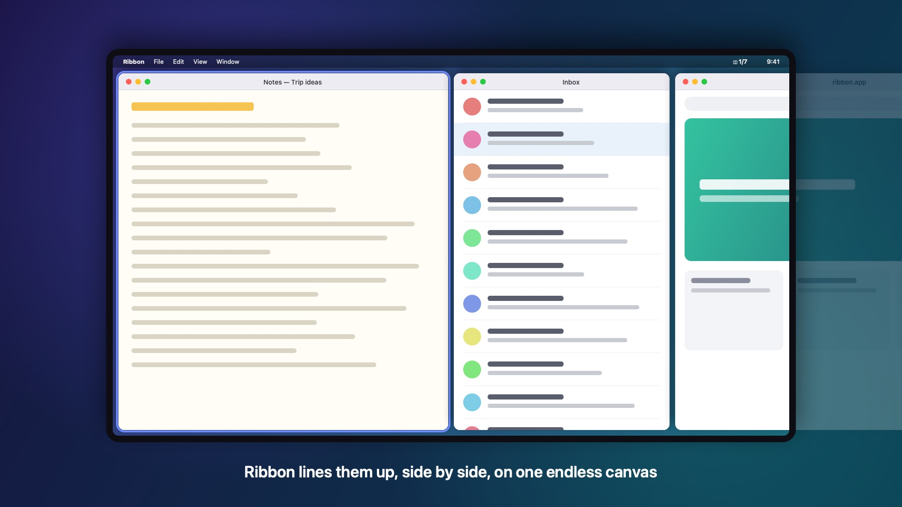
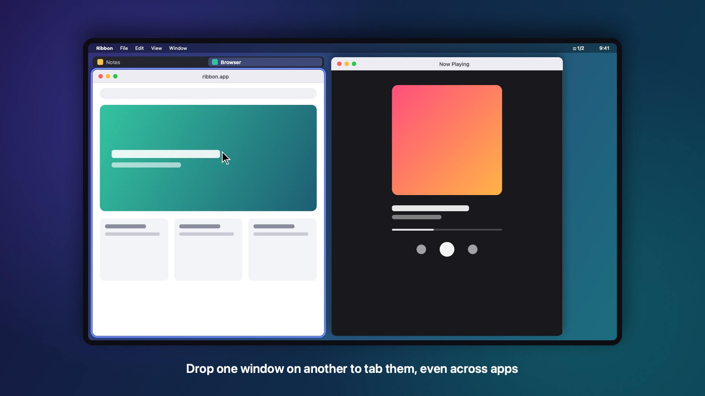

# Ribbon

[](https://github.com/TararaDotJoshua/ribbon/actions/workflows/ci.yml)

A scrolling window manager for macOS. Windows sit side by side in a horizontal
strip that extends past the edges of the screen, and the screen scrolls along
it. Each window keeps its own width. Inspired by niri, PaperWM and
[Paneru](https://github.com/karinushka/paneru).



There is a 34-second video tour in [media/ribbon-tour.mp4](media/ribbon-tour.mp4).

## Install

Requires macOS 14 or later and Swift 6 (Xcode 16 or the Command Line Tools).

```sh
git clone https://github.com/TararaDotJoshua/ribbon.git
cd ribbon
./scripts/bundle.sh --install
```

This builds `Ribbon.app`, copies it to `~/Applications` and launches it. Ribbon
runs in the menu bar.

Grant it Accessibility access in System Settings › Privacy & Security ›
Accessibility. The build is signed ad hoc, so after reinstalling, remove Ribbon
from that list and add it again.

macOS uses ⌃← and ⌃→ to switch Spaces. Ribbon intercepts them while it is on.
If Spaces still switch, turn off "Move left/right a space" in System Settings ›
Keyboard › Keyboard Shortcuts › Mission Control.

## Keys

| Keys | Action |
|---|---|
| ⌃← / ⌃→ | Focus the previous / next window |
| ⌃⇧← / ⌃⇧→ | Previous / next set of windows |
| ⌃⌥← / ⌃⌥→ | Narrower / wider, through the width presets |
| ⌃⌥R | Cycle the width presets |
| ⌃⌥- / ⌃⌥= | Narrower / wider by 5% |
| ⌃⌥F | Fill the screen, or restore the width |
| ⌃⌥C | Center the focused window |
| ⌃⌥⇧← / ⌃⌥⇧→ | Move the window left / right |
| ⌃⌥[ / ⌃⌥] | Tab the window into its left / right neighbour |
| ⌃⌥\ | Move the tab out of its group |
| ⌃⌥↑ / ⌃⌥↓ | Previous / next tab |
| ⌃⌥T | Float or tile the window |
| ⌃⌥P | Turn Ribbon off or on |
| ⌃⌥ + scroll | Pan the strip |

"Next set" moves the first window that isn't fully visible to the opposite edge
of the screen. Clicking a window or switching to it with ⌘Tab scrolls it into
view.

## Tab groups

Drag a window by its title bar onto the middle of another window and release
when "Add as Tab" appears. The windows can be from different apps. Click a tab
to switch to it. Drag a tab out of the bar, or right-click it, to remove it
from the group.



## Configuration

Settings are read from `~/.config/ribbon/config.json`. Every key is optional:

```json
{
  "gap": 8,
  "widthPresets": [0.3333, 0.5, 0.6667, 1.0],
  "defaultWidth": null,
  "widthStep": 0.05,
  "sliver": 5,
  "tabBarHeight": 28,
  "animationDuration": 0.12,
  "panModifiers": "ctrl+alt",
  "panSpeed": 1.0,
  "excludeApps": ["com.apple.systempreferences"],
  "bindings": { "cmd+alt+l": "focus-right", "ctrl+alt+t": "none" }
}
```

- Widths are fractions of the screen width.
- `defaultWidth: null` keeps a new window's own width.
- `sliver` is how many points of an off-screen window stay visible.
- `animationDuration` applies only when Smooth Motion is on in the menu.
- `excludeApps` takes bundle IDs or app names.
- `bindings` override the defaults; `"none"` removes a binding.

## Command line

```sh
Ribbon send <command>     # send a command to the running instance
Ribbon list               # list the windows Ribbon would tile
Ribbon --only <app>       # manage only this app (repeatable)
Ribbon --config <path>
```

The binary is `~/Applications/Ribbon.app/Contents/MacOS/Ribbon`. Commands:
`focus-left`, `focus-right`, `page-left`, `page-right`, `move-left`,
`move-right`, `grow`, `shrink`, `cycle-width`, `widen`, `narrow`,
`toggle-fill`, `center`, `toggle-float`, `tab-into-left`, `tab-into-right`,
`untab`, `prev-tab`, `next-tab`, `retile`, `toggle-pause`, `dump`, `quit`.

## Development

```sh
swift build
swift test
.build/debug/RibbonTestWindows 6 &
.build/debug/Ribbon --only RibbonTestWindows
```

`RibbonCore` holds the layout logic and has no AppKit dependency. `Ribbon` is
the app: the Accessibility bridge, event tap, tab bars and menu bar.
`scripts/make-video.swift` renders the tour video and screenshots.

Ribbon uses private macOS APIs (`_AXUIElementGetWindow` and SkyLight) to
identify and focus windows and to find their Space. A macOS update could break
them.

## Limitations

- Only the main display is managed.
- Dragging a window somewhere else snaps it back; use ⌃⌥⇧ + arrows to reorder.
- Full-screen windows, dialogs and panels are not tiled.
- A tab moved out of a group takes the group's width.

## License

MIT. See [LICENSE](LICENSE) and [THIRD_PARTY_NOTICES.md](THIRD_PARTY_NOTICES.md).
